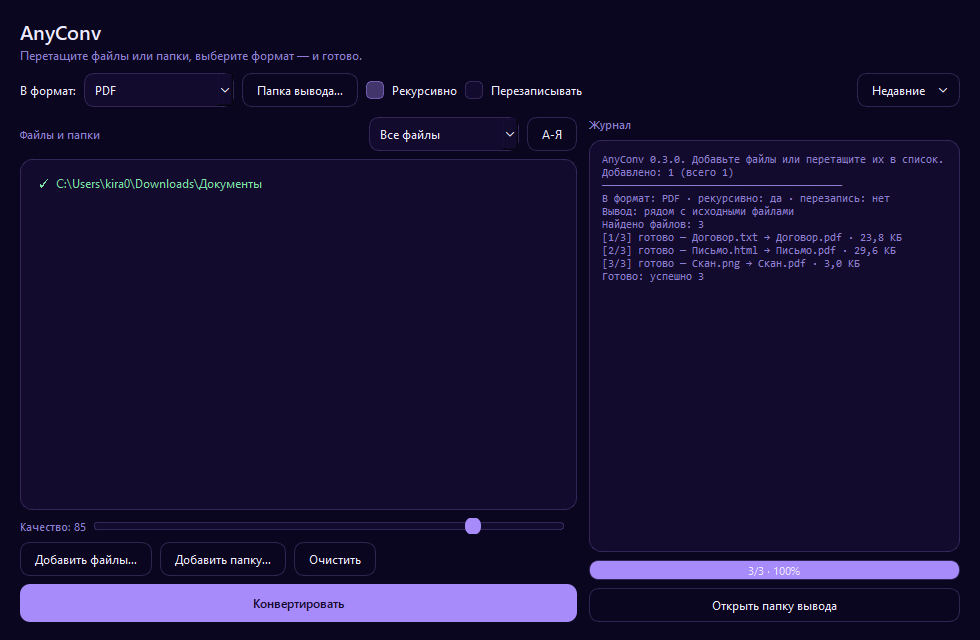

# AnyConv

GUI + CLI конвертер файлов для Windows 10/11.



## 📦 Скачать

➡ **[Скачать AnyConv для Windows](https://github.com/kirillsql1kaa11/anyconv/releases/latest)**

> Просто скачайте `AnyConv.exe` и запустите

## Что умеет

- **Изображения**: PNG, JPG, JPEG, WEBP → друг в друга и в PDF; BMP, TIFF, GIF → PDF
- **PDF**: → PNG/JPG постранично, → TXT, → DOCX
- **Документы**: MD → HTML, HTML → PDF, TXT → PDF, DOCX → PDF (через Microsoft Word)
- **Таблицы**: CSV ↔ XLSX
- **Архивы**: папка или файл → ZIP, ZIP → распаковка
- Пакетная обработка папок с сохранением структуры подпапок
- Кириллица, эмодзи в путях и содержимом, автоперенос строк в TXT → PDF

## GUI

- Перетащите файлы или папки прямо в окно и нажмите «Конвертировать»
- Прогресс с процентами и оставшимся временем, кнопка «Отмена»
- Статус каждого элемента (✓ готово / ! со пропусками / ✗ ошибка), двойной клик — детали
- Фильтр по типу файлов, сортировка, удаление по Del, выделение по Ctrl+A
- Слайдер качества JPEG/WebP с оценкой размера результата
- Список форматов показывает только то, что реально доступно для добавленных файлов
- Кнопка «Открыть папку вывода», список недавних папок
- Установка Chromium в один клик, автопроверка обновлений

## Список конвертаций

| Из | В |
|---|---|
| png | jpg, webp, pdf |
| jpg, jpeg | png, webp, pdf |
| webp | png, pdf |
| bmp, tif, tiff, gif | pdf |
| pdf | png, jpg, txt, docx |
| md | html |
| html | pdf |
| txt | pdf |
| docx | pdf *(нужен Word)* |
| csv | xlsx |
| xlsx | csv |
| папка или файл | zip |
| zip | unpack *(распаковать)* |

## CLI

```powershell
python -m anyconv.cli list
python -m anyconv.cli convert "C:\files" pdf --out "C:\files\out" --recursive
python -m anyconv.cli convert "photo.png" jpg --quality 70
python -m anyconv.cli convert "C:\docs" zip
python -m anyconv.cli convert "C:\docs.zip" unpack
python -m anyconv.cli check-update
```

## Установка из исходников

```powershell
py -m venv .venv
.\.venv\Scripts\activate
pip install -U pip
pip install typer rich pillow markdown pandas openpyxl reportlab playwright pyside6 pypdfium2 pypdf python-docx
python -m playwright install chromium
pip install pywin32   # опционально, только для DOCX → PDF через Microsoft Word

python -m anyconv.gui
```

## Сборка exe

```powershell
.\.venv\Scripts\pyinstaller.exe --noconfirm --clean --onefile --windowed --noupx ^
  --name AnyConv --icon anyconv\assets\icon.ico ^
  --add-data "anyconv\assets;anyconv\assets" ^
  --collect-submodules anyconv --collect-all playwright ^
  --collect-all pypdfium2 --collect-all pypdfium2_raw ^
  --hidden-import win32com.client run_gui.py
```

Готовый файл появится в `dist\AnyConv.exe`. В корне лежит `AnyConv.spec` — можно собрать через `pyinstaller AnyConv.spec`.

## FAQ

- **HTML → PDF требует Chromium** (~150 МБ). Приложение предложит установить его одним нажатием; вручную: `python -m playwright install chromium`.
- **DOCX → PDF работает только с установленным Microsoft Word** (и пакетом pywin32). Для всего остального Word не нужен.
- **PDF → TXT/DOCX** извлекает текстовый слой. Сканы без текстового слоя не распознаются (OCR не входит).
- **PDF → PNG/JPG** создаёт по файлу на страницу: `имя_01.png`, `имя_02.png`…
- При выводе в отдельную папку **структура подпапок сохраняется**, файлы с одинаковыми именами не перезатираются: `имя (2).pdf`.

## Лицензия

MIT — см. [LICENSE](LICENSE).
